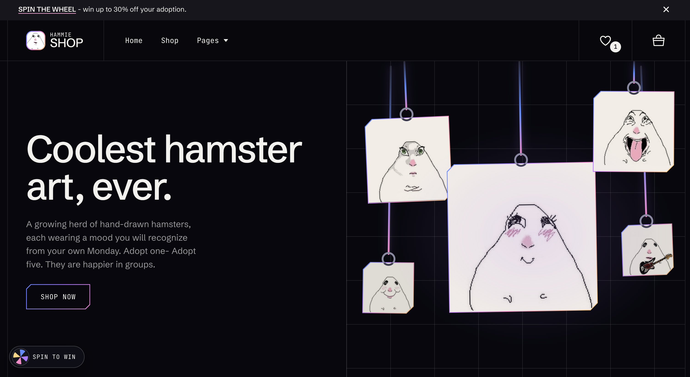

# Hammie Shop

A small just-for-fun webshop for hamsters depicting different moods, built with Streamlit.

<p align="center">
  
</p>

You can browse 56 hamster moods, search by name
or mood, filter by new, on sale or saved, and heart the ones you like. Open any
hamster for its own page and add it to the cart. Spend $150 and a free mystery
sticker joins your order.

<p align="center">
  
</p>


New visitors get a **spin-the-wheel** popup: every slice wins a discount code
(5–30% off) that is applied to the cart automatically. Codes can also be typed
in the cart.

Checkout takes Apple Pay. Tap the apples (each is worth $5, the pizza, lemons and
eggplants are decoys) until you have collected the total, and the payment goes
through. No real money is involved unless you want to donate :).

## Run it locally

Needs [uv](https://docs.astral.sh/uv/), uv installs the right Python and the
dependencies for you on the first run.

```bash
uv run streamlit run app.py
```

## What is where

| Path | What it is |
| --- | --- |
| `pyproject.toml`, `uv.lock`, `.python-version` | Dependencies and Python version, managed by uv. |
| `app.py` | Streamlit entry point. Inlines the images and renders the shop full-screen. |
| `hamster_images/hamster_what.JPG` | Also the shop's logo and browser-tab icon. |
| `products.py` | The catalog (names, moods, descriptions, prices $50–$100) and the fruit for the checkout game. Edit freely. |
| `shop/index.html`, `shop/styles.css`, `shop/app.js` | The storefront: layout, styles, cart and animations. |
| `hamster_images/` | The hamster drawings (the products). Each new drop gets its own folder (`wave_2/`, `wave_3/`…); the newest folder's hamsters are tagged NEW. |
| `food_icons/` | The fruit that falls during the Apple Pay checkout. |

The cart is saved in the visitor's own browser, so it survives a refresh.
